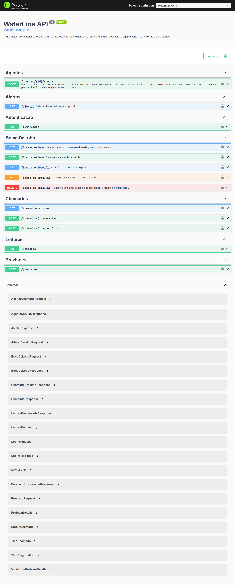
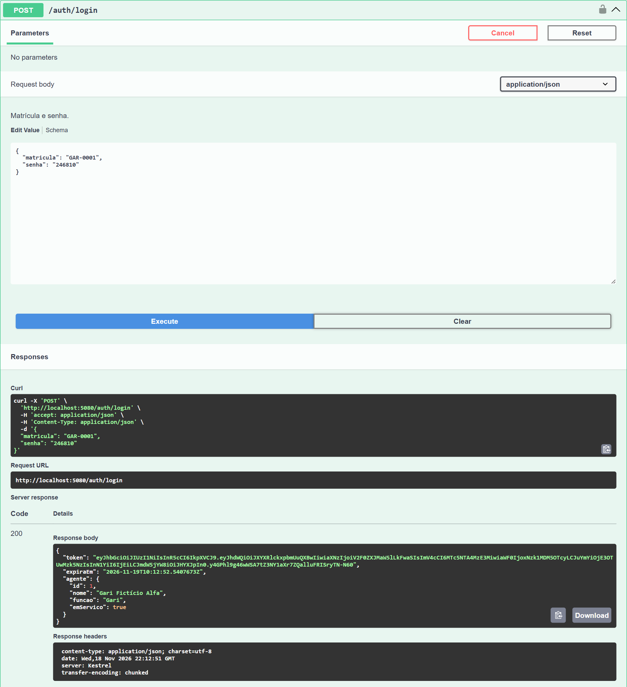
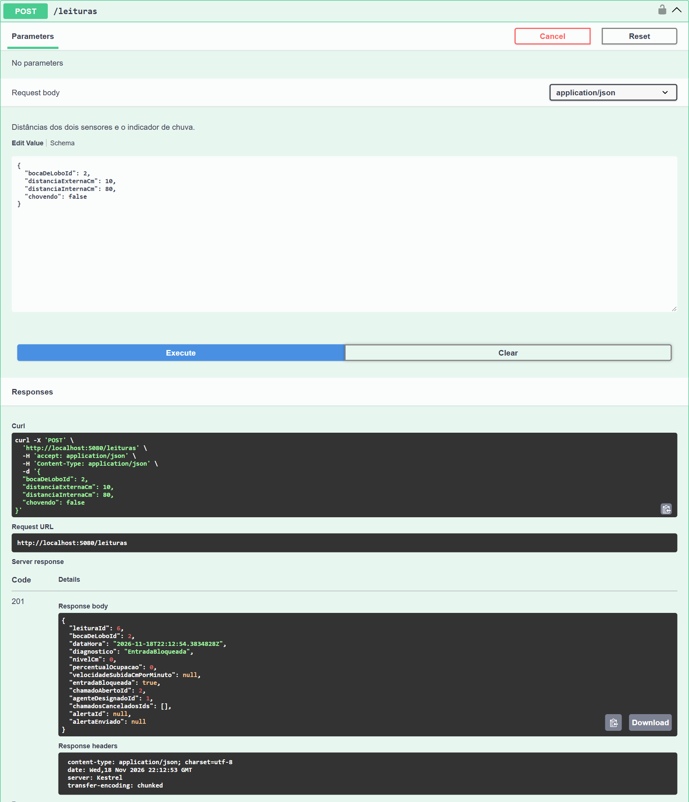
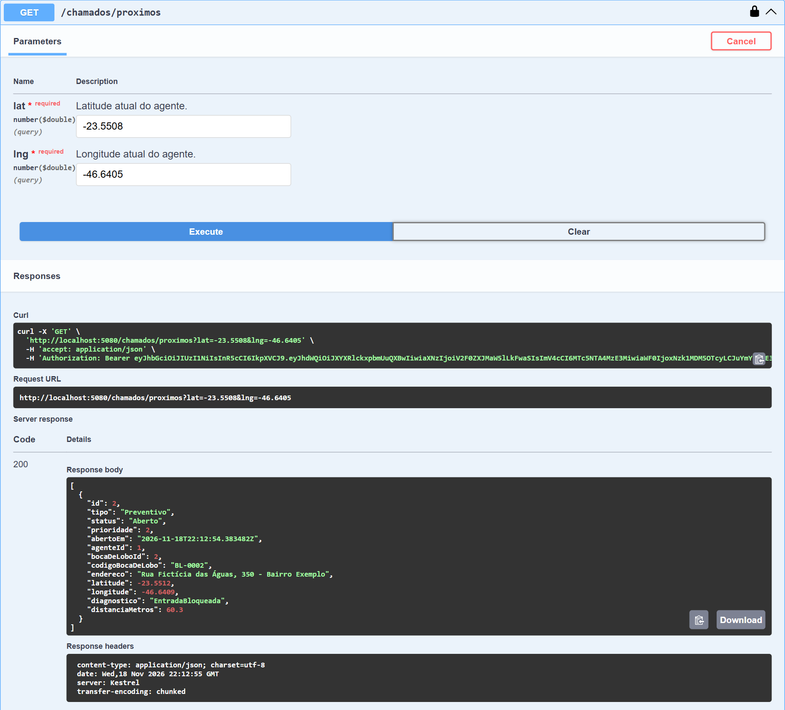
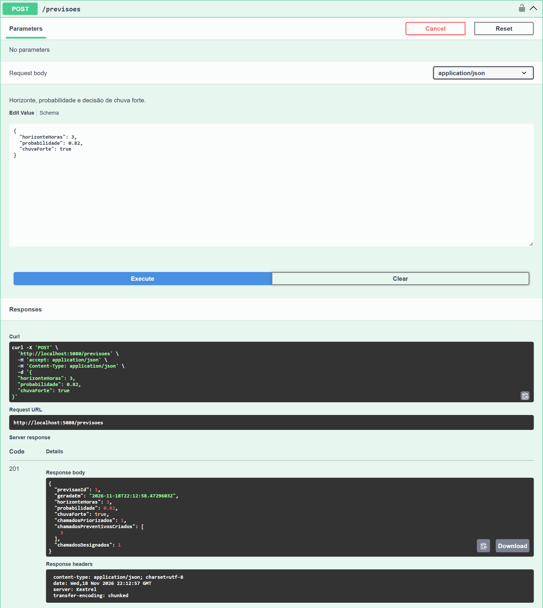
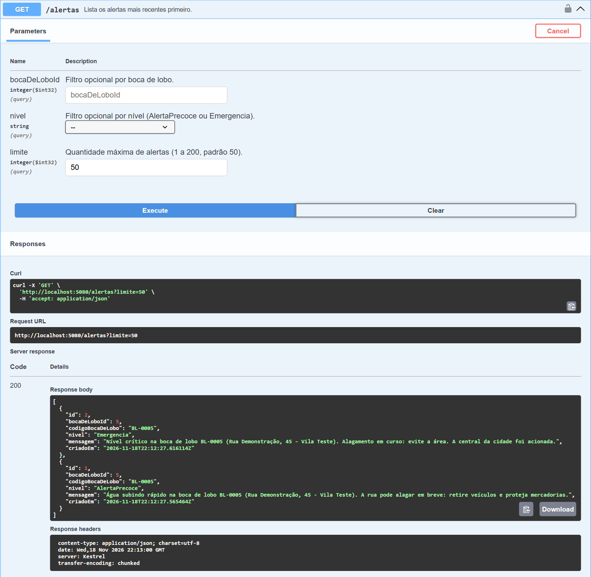
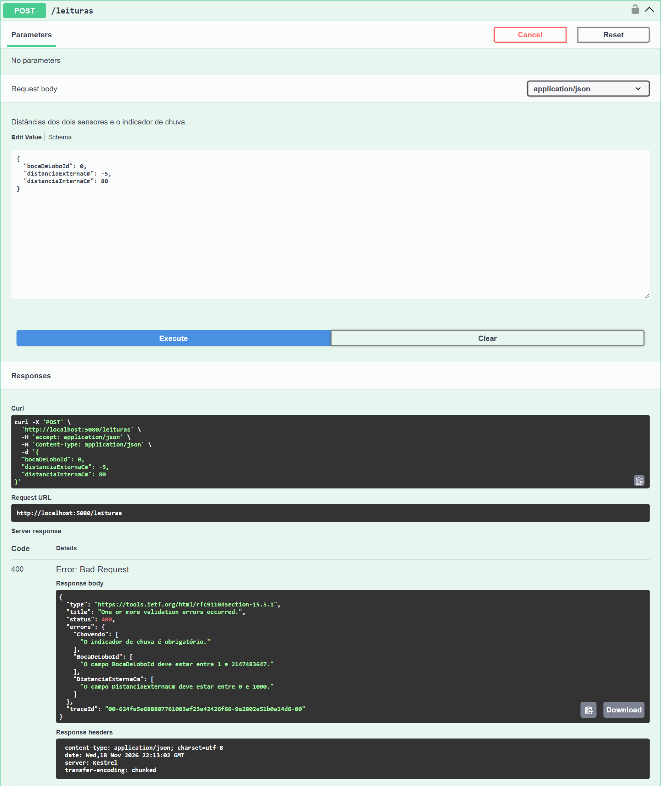

# WaterLine API

API principal do **WaterLine**, a CitizenTech da Global Solution 2026.2 (FIAP), entregue na disciplina **C# Software Development**.

O WaterLine monitora bocas de lobo em São Paulo para reduzir alagamentos. Cada boca de lobo tem um ESP32 com dois sensores ultrassônicos: o **externo** detecta lixo tampando a entrada, e o **interno** mede o fundo da caixa e o nível da água. Há também um indicador de chuva. Esta API é o centro do sistema: recebe as leituras, diagnostica, abre chamados, despacha o agente certo mais próximo e gera alertas.

| Camada | Quando | O que a API faz |
| --- | --- | --- |
| 0. Manutenção contínua | O ano todo | Sedimento ou tubo entupido abrem chamado para a equipe de galeria |
| 1. Prevenção | Previsão de chuva forte (ML) | Eleva a prioridade dos chamados ativos e cria chamados preventivos para bocas com histórico de entupimento |
| 2. Alerta precoce | Chovendo e água subindo rápido | Grava um alerta e chama o serviço de alertas |
| 3. Emergência | Chovendo e nível crítico | Grava um alerta de emergência e chama o serviço de alertas (central) |

Todos os dados do seed são **fictícios**: nenhum nome, matrícula ou endereço é real.

## Ficha da CitizenTech

| Campo | Conteúdo |
| --- | --- |
| Nome da CitizenTech | WaterLine |
| Cidade e bairro | São Paulo, Centro (Sé/República) – Vale do Anhangabaú e Terminal Bandeira. Na chuva de 14/10/2026, o Túnel do Anhangabaú e o Terminal Bandeira alagaram, com carros boiando ([Agência Brasil](https://agenciabrasil.ebc.com.br/meio-ambiente/noticia/2026-10/chuva-alaga-ruas-do-centro-e-deixa-um-morto-na-zona-norte-de-sao-paulo), [TMC](https://tmc.com.br/brasil/chuva-sp-alaga-terminal-bandeira-metro-trianon-alertas/)). |
| Cidadão beneficiado | Morador e pequeno comerciante de rua com alagamento recorrente; gari e equipe de galeria como agentes públicos |
| Problema, em uma frase | Bocas de lobo entupidas transformam chuva comum em alagamento, e a limpeza e o aviso chegam tarde porque ninguém sabe a tempo onde agir. |
| Como funciona | Sensores na boca de lobo detectam entupimento externo e interno e a água subindo; o ML prevê chuva forte; a API despacha o agente certo mais próximo e alerta moradores e a central. |
| O que cada parte faz | ESP32 mede e diagnostica; **API C# decide prioridade e despacho**; app do gari recebe e fecha chamados com foto; ML prevê chuva forte com dados do INMET; módulo de segurança protege localização e fotos; Linux hospeda API e painel; Azure Boards organiza features e testes. |
| Link do repositório | https://github.com/Carlosqmenezes/Water-Line_GS_C-Sharp (API) e https://github.com/Carlosqmenezes/Water-Line_GS-MOBILE (app) |
| Indicador de impacto | Tempo entre a detecção e a limpeza; % de bocas de lobo prioritárias verificadas antes de chuva forte; minutos de antecedência entre o alerta e o nível crítico. |
| ODS conectados | 11, 13, 9, 3 e 8 (trabalho decente: a localização do trabalhador só é usada em serviço) |

## Integrantes

| Nome | RM |
| --- | --- |
| Carlos Eduardo de Queiroz Menezes | RM99849 |
| Leonardo Correia | RM550413 |

## Repositórios do projeto

| Parte | Repositório |
| --- | --- |
| API principal (C#), este repositório | https://github.com/Carlosqmenezes/Water-Line_GS_C-Sharp |
| App do gari (Mobile, Expo) | https://github.com/Carlosqmenezes/Water-Line_GS-MOBILE |

O app do gari consome esta API: para testá-lo no celular, primeiro suba a API seguindo o passo a passo abaixo (incluindo a seção [Acesso pelo celular](#6-acesso-pelo-celular-app-do-gari)).

---

## Tecnologias

| Item | Versão |
| --- | --- |
| .NET / ASP.NET Core Web API (controllers) | 8.0 (LTS) |
| Entity Framework Core + Npgsql (PostgreSQL) | 8.0.34 / 8.0.11 |
| PostgreSQL (Docker) | 16 (imagem `postgres:16-alpine`) |
| Swagger UI (Swashbuckle.AspNetCore) | 9.0.6 |
| Autenticação JWT (Microsoft.AspNetCore.Authentication.JwtBearer) | 8.0.34 |
| Testes | xUnit 2.9.3 |
| Ferramenta de migrations | `dotnet-ef` 8.0.34 (ferramenta local, em `dotnet-tools.json`) |

**Biblioteca além das pedidas no enunciado.** `Microsoft.AspNetCore.Authentication.JwtBearer` é o pacote oficial da Microsoft para validar tokens JWT no ASP.NET Core. Ele foi adicionado para o login do app do gari: sem ele, a validação da assinatura e da validade do token teria de ser escrita à mão, o que é mais arriscado do que usar a implementação padrão. O hash da senha (`PasswordHasher`, PBKDF2) e o limite de tentativas de login já fazem parte do ASP.NET Core e não exigiram pacote novo.

## Estrutura da solução

```
WaterLine.Api/
├── WaterLine.sln
├── docker-compose.yml            PostgreSQL para desenvolvimento
├── dotnet-tools.json             versão fixa do dotnet-ef
├── src/
│   ├── WaterLine.Domain/         regras de negócio, sem dependências externas
│   │   ├── Entidades/            BocaDeLobo, Leitura, Agente (abstrata), Gari, EquipeGaleria, Chamado, PrevisaoChuva, Alerta
│   │   ├── Enums/                TipoDiagnostico, TipoChamado, StatusChamado, NivelAlerta
│   │   ├── Interfaces/           IDiagnosticoService, IDespachoService, IAlertaClient, ...
│   │   ├── Servicos/             implementação das regras (diagnóstico, despacho, prevenção, segurança)
│   │   ├── Configuracoes/        parâmetros das regras (lidos do appsettings.json)
│   │   ├── Geo/                  Haversine
│   │   └── Excecoes/             exceções de domínio (viram 404, 409 e 422)
│   └── WaterLine.Api/            camada web e de infraestrutura
│       ├── Controllers/          rotas REST
│       ├── Dtos/                 contratos de entrada e saída, com validação
│       ├── Servicos/             casos de uso (orquestram domínio e banco)
│       ├── Dados/                DbContext, mapeamentos Fluent API, migrations e seed
│       ├── Autenticacao/         token JWT (emissão e leitura do agente autenticado)
│       ├── Integracoes/          clientes do serviço de alertas (HTTP ou log)
│       ├── Armazenamento/        gravação das fotos dos chamados
│       ├── Erros/                tratamento global de erros (ProblemDetails)
│       └── Configuracao/         registro de injeção de dependência
└── tests/
    └── WaterLine.Tests/          testes unitários xUnit do domínio e do token de login
```

Referências entre projetos: `WaterLine.Api → WaterLine.Domain` e `WaterLine.Tests → WaterLine.Domain` e `WaterLine.Api` (esta última só para testar a emissão do token).

---

## Como executar (passo a passo)

### O que vai rodar

| Peça | Onde roda | Endereço |
| --- | --- | --- |
| Banco PostgreSQL 16 | Container Docker `waterline-postgres` | `127.0.0.1:5432` |
| API WaterLine | Seu computador (.NET 8) | `http://localhost:5080` |
| Documentação Swagger | Servida pela própria API | `http://localhost:5080/swagger` |

O caminho completo, na primeira vez, é: **instalar os programas → baixar o código → subir o banco → criar as tabelas → rodar a API → testar no Swagger**. Da segunda vez em diante bastam os passos 3 e 5.

### 1. Instalar os pré-requisitos (uma vez só)

| Programa | Versão | Para quê | Onde baixar | Como conferir se está instalado |
| --- | --- | --- | --- | --- |
| **Git** | qualquer recente | Baixar o código | https://git-scm.com/downloads | `git --version` |
| **Visual Studio 2022** (17.8 ou superior) ou **Visual Studio 2026** | — | Abrir e rodar a solução | https://visualstudio.microsoft.com/pt-br/ | Na instalação, marque a carga de trabalho **ASP.NET e desenvolvimento Web** |
| **SDK do .NET 8** | 8.0.x | Compilar e rodar a API | Já vem com a carga de trabalho acima, ou em https://dotnet.microsoft.com/download/dotnet/8.0 | `dotnet --list-sdks` deve listar uma versão `8.0.x` |
| **Docker Desktop** | qualquer recente | Rodar o PostgreSQL sem instalar nada no Windows | https://www.docker.com/products/docker-desktop/ | `docker --version`, e o ícone da baleia na bandeja do Windows parado (não animado) |

Observações:

- O Visual Studio não é obrigatório: tudo pode ser feito só com o SDK do .NET 8 e um terminal (PowerShell). Ele só deixa a execução mais simples (botão F5).
- O Docker Desktop precisa estar **aberto e em execução** sempre que você for usar a API. Na primeira abertura ele pode pedir para ativar o WSL 2; aceite e reinicie o computador se ele pedir.
- A porta **5432** precisa estar livre. Se você já tem um PostgreSQL instalado nessa porta, pare o serviço dele (em `services.msc`) ou troque a porta no `docker-compose.yml` e na connection string do `appsettings.Development.json`.
- Não é preciso instalar o PostgreSQL nem o `dotnet-ef`: o banco vem do Docker e a ferramenta de migrations é restaurada pelo próprio projeto (`dotnet-tools.json`).

### 2. Baixar o código

Abra o PowerShell na pasta onde quer guardar o projeto e rode:

```powershell
git clone https://github.com/Carlosqmenezes/Water-Line_GS_C-Sharp.git
cd Water-Line_GS_C-Sharp
```

Todos os comandos a seguir são executados **nesta pasta** (a que contém o `WaterLine.sln` e o `docker-compose.yml`).

> **Onde digitar os comandos.** Funcionam em qualquer um destes lugares:
> - **PowerShell** do Windows, dentro da pasta do projeto;
> - **Visual Studio → Exibir → Terminal**;
> - **Visual Studio → Ferramentas → Gerenciador de Pacotes do NuGet → Console do Gerenciador de Pacotes**. Esse console já abre na pasta da solução. Ele mostra em **vermelho, com `NativeCommandError`**, qualquer mensagem informativa que o `docker` e o `dotnet` escrevem (por exemplo `Container waterline-postgres Running` ou `Usando as configurações de inicialização...`). **Isso não é erro**: só é erro de verdade se a mensagem disser `error` ou `falha`.

### 3. Subir o banco de dados

Com o Docker Desktop aberto:

```powershell
docker compose up -d
docker compose ps
```

O primeiro comando baixa a imagem `postgres:16-alpine` (só na primeira vez) e cria o container. O segundo deve mostrar o serviço `postgres` com o status **healthy**; se aparecer `starting`, espere alguns segundos e rode `docker compose ps` de novo.

O banco `waterline` fica em `127.0.0.1:5432` (usuário `waterline`, senha `waterline_dev`, **só para desenvolvimento**). Os dados ficam guardados num volume do Docker e continuam lá mesmo depois de desligar o computador.

> A connection string usa `127.0.0.1`, e não `localhost`, de propósito. Em alguns Windows, outro processo escuta em `::1:5432` (o IPv6 de `localhost`), e a conexão fica presa até dar timeout em vez de chegar ao container.

### 4. Criar as tabelas (migrations)

Só é necessário na primeira vez, ou depois de zerar o banco:

```powershell
dotnet tool restore
dotnet tool run dotnet-ef database update --project src/WaterLine.Api
```

- `dotnet tool restore` instala a versão certa do `dotnet-ef` (8.0.34) só para este projeto.
- `database update` cria as tabelas `BocasDeLobo`, `Leituras`, `Agentes`, `Chamados`, `PrevisoesChuva` e `Alertas`. No fim deve aparecer `Done.`.

### 5. Rodar a API

Escolha **uma** das formas abaixo.

**A) Pelo Visual Studio (F5)**

1. Abra o arquivo `WaterLine.sln`.
2. No Gerenciador de Soluções, clique com o botão direito em **WaterLine.Api** e escolha **Definir como Projeto de Inicialização**.
3. Confira se o perfil de execução (ao lado do botão verde) é **http**.
4. Aperte **F5**. O navegador abre sozinho em **http://localhost:5080/swagger**.

**B) Por linha de comando** (PowerShell, terminal do Visual Studio ou Console do Gerenciador de Pacotes)

```powershell
dotnet run --project src\WaterLine.Api --launch-profile http
```

A API está no ar quando aparecer `Now listening on: http://localhost:5080`. Abra **http://localhost:5080/swagger** no navegador. O terminal fica ocupado enquanto a API roda; para parar, aperte **Ctrl+C**.

Na primeira execução em `Development`, o **seed** cria 5 bocas de lobo e 5 agentes fictícios (3 garis e 2 equipes de galeria), todos fora de serviço, com a senha de demonstração `246810`. O seed só roda com o banco migrado e vazio. Se o banco não estiver no ar, a API sobe mesmo assim e registra o erro no console.

### 6. Acesso pelo celular (app do gari)

Com as formas acima, a API só aceita conexões do próprio computador (`localhost`). Para o app do gari, rodando no celular, conseguir chegar nela:

**6.1. Rode a API ouvindo na rede** (no lugar do passo 5):

```powershell
dotnet run --project src\WaterLine.Api --launch-profile http --urls http://0.0.0.0:5080
```

Deve aparecer `Now listening on: http://0.0.0.0:5080`.

**6.2. Descubra o IP do computador na rede Wi-Fi:**

```powershell
ipconfig
```

Procure o bloco **Adaptador de Rede sem Fio Wi-Fi** e anote o **Endereço IPv4** (por exemplo `192.168.15.5`). Ignore os adaptadores virtuais, como `vEthernet (WSL)` (`172.x.x.x`) e `VirtualBox`/`Ethernet 2` (`192.168.56.x`): o celular não alcança esses endereços.

**6.3. Libere a porta 5080 no Firewall do Windows** (uma vez só). Abra um PowerShell **como administrador** e rode:

```powershell
New-NetFirewallRule -DisplayName "WaterLine API 5080" -Direction Inbound -Protocol TCP -LocalPort 5080 -Action Allow
```

**6.4. Teste pelo celular:** conectado ao **mesmo Wi-Fi** do computador, abra no navegador do celular `http://SEU_IP:5080/swagger` (digitando o `http://`). Se a página do Swagger abrir, o app também vai conseguir conversar com a API. Agora siga o README do app: https://github.com/Carlosqmenezes/Water-Line_GS-MOBILE

### 7. Conferir que tudo funciona

1. Em **http://localhost:5080/swagger**, abra `GET /bocas-de-lobo` → **Try it out** → **Execute**. A resposta deve ser **200** com as 5 bocas de lobo do seed.
2. Faça o login de teste em `POST /auth/login` com `{ "matricula": "GAR-0001", "senha": "246810" }`. A resposta deve ser **200** com um `token`.
3. Siga o [Roteiro de teste no Swagger](#roteiro-de-teste-no-swagger) para ver as regras de negócio funcionando.

### 8. Rodar os testes automatizados

```powershell
dotnet test
```

No Visual Studio: **Teste → Gerenciador de Testes → Executar Todos**. Os testes são unitários e não precisam do banco nem da API no ar.

### 9. Ligar o serviço de alertas (opcional)

Sem configuração, os alertas ficam gravados no banco e só são registrados em log. Para enviá-los a um serviço de alertas externo (por exemplo, rodando em `http://localhost:5090`), defina a variável antes de rodar a API, no mesmo terminal:

```powershell
$env:Alertas__BaseUrl = "http://localhost:5090"
dotnet run --project src\WaterLine.Api --launch-profile http
```

### Parar e zerar

| O que fazer | Comando |
| --- | --- |
| Parar a API | **Ctrl+C** no terminal (ou **Shift+F5** no Visual Studio) |
| Parar o banco, mantendo os dados | `docker compose stop` |
| Ligar o banco de novo | `docker compose up -d` |
| Apagar o banco e começar do zero (o seed roda de novo) | `docker compose down -v`, depois `docker compose up -d` e `dotnet tool run dotnet-ef database update --project src/WaterLine.Api` |

### Problemas comuns

| Sintoma | Causa | Solução |
| --- | --- | --- |
| Linhas vermelhas com `NativeCommandError` no Console do Gerenciador de Pacotes | O console trata como erro toda mensagem informativa do `docker`/`dotnet` | Pode ignorar; confira só se aparece `error` ou `falha` |
| `docker: command not found` ou `error during connect` | Docker Desktop fechado ou não instalado | Abra o Docker Desktop e espere a baleia parar de animar |
| `port is already allocated` ao subir o banco | Outro PostgreSQL usando a porta 5432 | Pare o outro PostgreSQL ou troque a porta (veja o passo 1) |
| A API sobe, mas o console mostra erro de conexão com o banco | Banco desligado ou migrations não aplicadas | Rode o passo 3 e o passo 4 e reinicie a API |
| `Failed to bind to address http://...:5080: address already in use` | A API já está rodando em outro terminal | Feche a outra execução (Ctrl+C) ou encerre o processo `WaterLine.Api` no Gerenciador de Tarefas |
| Login responde **401** | Matrícula ou senha erradas | Use `GAR-0001` e `246810` |
| Login responde **429** | Mais de 10 tentativas de login em um minuto | Espere um minuto |
| O celular não abre `http://SEU_IP:5080/swagger` | API ouvindo só em `localhost`, firewall bloqueando ou celular em outra rede | Refaça os passos 6.1 a 6.3 e confira se o celular está no mesmo Wi-Fi, sem VPN e com os dados móveis desligados |
| O Chrome do celular mostra `ERR_SSL_PROTOCOL_ERROR` | O navegador trocou o endereço para `https://`, e a API de desenvolvimento só fala `http` | Digite o endereço completo começando com `http://` (ou use uma aba anônima) |

---

## Roteiro de teste no Swagger

Os Ids abaixo são os do seed num banco recém-criado: agentes 1 a 3 são garis, 4 e 5 são equipes de galeria, e as bocas de lobo vão de 1 a 5. Confira com `GET /bocas-de-lobo`. A boca de lobo padrão tem 80 cm de profundidade e 50 cm de abertura.

**Antes de tudo: login.** As rotas do agente (`/agentes` e `/chamados`) exigem token.

1. `POST /auth/login` com a matrícula e a senha de demonstração do seed:
   ```json
   { "matricula": "GAR-0001", "senha": "246810" }
   ```
2. Copie o valor de `token` da resposta, clique em **Authorize** no topo do Swagger, cole o token (sem a palavra `Bearer`) e confirme.

Os agentes do seed são `GAR-0001` a `GAR-0003` (garis, Ids 1 a 3) e `GAL-0001` e `GAL-0002` (equipes de galeria, Ids 4 e 5), todos com a senha de `Seed:SenhaDemonstracao`. O token do gari 1 só vale para ações do gari 1: com outro `agenteId`, a resposta é **403**.

**A. Entrada bloqueada → gari → conclusão com foto**

1. `POST /agentes/1/servico`: o gari 1 entra em serviço perto da BL-0001.
   ```json
   { "emServico": true, "latitude": -23.5502, "longitude": -46.6401 }
   ```
2. `POST /leituras`: lixo tampando a entrada (10 cm é menor que 70% de 50 cm).
   ```json
   { "bocaDeLoboId": 1, "distanciaExternaCm": 10, "distanciaInternaCm": 80, "chovendo": false }
   ```
   Resposta esperada: `"diagnostico": "EntradaBloqueada"`, com um `chamadoAbertoId` e `"agenteDesignadoId": 1`.
3. `GET /chamados/proximos?lat=-23.5502&lng=-46.6401`: o chamado aparece com a distância.
4. `POST /chamados/{id}/aceitar` com `{ "agenteId": 1 }` → 200.
5. `POST /chamados/{id}/concluir` com `agenteId = 1` e duas imagens JPEG ou PNG → **422**, porque o sensor ainda mostra a entrada bloqueada.
6. `POST /leituras` com a entrada livre: `{ "bocaDeLoboId": 1, "distanciaExternaCm": 50, "distanciaInternaCm": 80, "chovendo": false }`.
7. Repita o passo 5 → **200**, status `Concluido`. Sem uma das fotos → **422**.

**B. Chuva: cancelamento por segurança, alerta precoce e emergência**

1. `POST /leituras` com `{ "bocaDeLoboId": 2, "distanciaExternaCm": 10, "distanciaInternaCm": 80, "chovendo": false }`: abre um chamado de gari na BL-0002.
2. `POST /leituras` com `{ "bocaDeLoboId": 2, "distanciaExternaCm": 10, "distanciaInternaCm": 80, "chovendo": true }`: começou a chover, e o chamado aparece em `chamadosCanceladosIds`. Nenhum gari é chamado enquanto chove.
3. `POST /leituras` com `{ "bocaDeLoboId": 2, "distanciaExternaCm": 50, "distanciaInternaCm": 60, "chovendo": true }`: a água subiu 20 cm desde a leitura anterior, então o diagnóstico é `AguaSubindo` e a resposta traz um `alertaId`. A velocidade é calculada pela diferença de `dataHora` entre as leituras; sem `dataHora`, vale a hora do servidor.
4. `POST /leituras` com `{ "bocaDeLoboId": 2, "distanciaExternaCm": 50, "distanciaInternaCm": 8, "chovendo": true }`: 90% de ocupação, então o diagnóstico é `NivelCritico` (alerta de emergência).
5. `GET /alertas`: os dois alertas aparecem, o mais recente primeiro.

**C. Manutenção da equipe de galeria**

- `POST /leituras` com `{ "bocaDeLoboId": 3, "distanciaExternaCm": 60, "distanciaInternaCm": 54, "chovendo": false }`: 40% de ocupação sem chuva, então o diagnóstico é `SedimentoAcumulando` e abre um chamado `Manutencao` para a equipe de galeria.

**D. Previsão de chuva forte**

- `POST /previsoes` com `{ "horizonteHoras": 3, "probabilidade": 0.82, "chuvaForte": true }`: a resposta mostra quantos chamados foram priorizados e os Ids dos preventivos criados.

---

## Evidências (prints do Swagger)

Capturados com a API rodando localmente, com os dados fictícios do seed. Os prints ficam em [`docs/prints`](docs/prints).

**Visão geral da documentação**, com todas as rotas e o botão **Authorize**:



**1. Login do gari** (`POST /auth/login` → 200 com o token JWT):



**2. Leitura do sensor com a entrada tampada** (`POST /leituras` → 201): o diagnóstico é `EntradaBloqueada`, um chamado é aberto e o gari mais próximo em serviço é designado.



**3. Chamados próximos do gari** (`GET /chamados/proximos`, rota protegida → 200): ordenados por prioridade e distância, calculada pela fórmula de Haversine.



**4. Previsão de chuva forte vinda do ML** (`POST /previsoes` → 201): prioridades elevadas e chamados preventivos criados.



**5. Alertas gerados pela chuva** (`GET /alertas` → 200): alerta precoce (água subindo) e emergência (nível crítico).



**6. Validação de entrada** (`POST /leituras` com dados inválidos → 400 em ProblemDetails, com os campos que falharam):



---

## Endpoints

Todos os endpoints são assíncronos, recebem e devolvem DTOs, e os erros seguem o padrão **ProblemDetails** (RFC 7807).

| Método | Rota | Quem usa | Sucesso | Erros |
| --- | --- | --- | --- | --- |
| POST | `/leituras` | ESP32 | 201 com o diagnóstico e as ações tomadas | 400, 404, 422 (boca inativa) |
| GET | `/bocas-de-lobo?ativa=` | Painel | 200 | — |
| GET | `/bocas-de-lobo/{id}` | Painel | 200 | 404 |
| POST | `/bocas-de-lobo` | Painel | 201 + `Location` | 400, 409 (código repetido) |
| PUT | `/bocas-de-lobo/{id}` | Painel | 200 | 400, 404, 409 |
| DELETE | `/bocas-de-lobo/{id}` | Painel | 204 (exclusão lógica) | 404 |
| POST | `/auth/login` | App do gari | 200 com `token`, `expiraEm` e os dados do agente | 400, 401 (matrícula ou senha incorretas), 429 (muitas tentativas) |
| GET | `/chamados/proximos?lat=&lng=` 🔒 | App do gari | 200, ordenado por prioridade e distância | 400, 401 |
| POST | `/chamados/{id}/aceitar` 🔒 | App do gari | 200 | 400, 401, 403, 404, 409, 422 (fora do raio, fora de serviço ou tipo errado) |
| POST | `/chamados/{id}/concluir` 🔒 | App do gari (multipart: `agenteId`, `fotoAntes`, `fotoDepois`) | 200 | 400 (foto inválida), 401, 403, 404, 409, 422 (sem foto ou sensor sem confirmar) |
| POST | `/previsoes` | Modelo de ML | 201 com o resumo da prevenção | 400 |
| GET | `/alertas?bocaDeLoboId=&nivel=&limite=` | Painel / central | 200 | 400 |
| POST | `/agentes/{id}/servico` 🔒 | App do gari | 200 | 400, 401, 403, 404 |

🔒 Exige o cabeçalho `Authorization: Bearer {token}`. Sem token, ou com token vencido, a resposta é **401**. Com o token de outro agente, **403**.

---

## Autenticação

O app do gari entra com **matrícula e senha** e recebe um **token JWT** assinado (HMAC-SHA256), válido por `Jwt:ExpiracaoHoras` (12 horas, um turno).

| Ponto | Como foi feito |
| --- | --- |
| Senha | Guardada só como hash (`PasswordHasher` do ASP.NET Core: PBKDF2 com sal), na coluna `SenhaHash`. A senha em texto nunca é gravada nem registrada em log. |
| Token | Leva só o Id e a função do agente (`sub` e `funcao`). Nome e matrícula ficam de fora, porque o conteúdo de um JWT é legível. |
| Rotas protegidas | `[Authorize]` em `AgentesController` e `ChamadosController`. |
| Um agente não age por outro | O Id da rota ou do corpo precisa ser o do token (`AgenteAutenticado.GarantirMesmoAgente`); senão, 403. |
| Login recusado | A mensagem é sempre "Matrícula ou senha incorretas.", exista a matrícula ou não, e o tempo de resposta é o mesmo nos dois casos. |
| Força bruta | No máximo 10 tentativas de login por minuto por endereço IP (429 depois disso). |
| Chave de assinatura | `Jwt:Chave`, com 32 caracteres ou mais. Em desenvolvimento vem do `appsettings.Development.json`; fora dele, da variável de ambiente `Jwt__Chave`. Sem chave válida a API não sobe. |

As rotas do ESP32 (`/leituras`), do modelo de ML (`/previsoes`) e do painel (`/bocas-de-lobo`, `/alertas`) continuam abertas, para os outros módulos do projeto seguirem funcionando; veja as limitações.

---

## Regras de negócio

Todos os parâmetros ficam no `appsettings.json`, na seção `Regras`, e são validados quando a API sobe: um valor inválido impede a inicialização.

**1. Diagnóstico** (`DiagnosticoService`). Cálculos: `nível = ProfundidadeCm − DistanciaInternaCm` e `percentual = nível ÷ profundidade`.

| Condição | Diagnóstico | Parâmetro |
| --- | --- | --- |
| Chovendo e percentual ≥ 85% | `NivelCritico` | `PercentualNivelCritico` |
| Chovendo e subida ≥ 5 cm/min desde a leitura anterior | `AguaSubindo` | `VelocidadeSubidaCmPorMinuto` |
| Sem chuva e percentual ≥ 60% há mais de 24 h | `TuboEntupido` | `PercentualTuboEntupido`, `HorasAguaParadaTubo` |
| `DistanciaExternaCm` < 70% da largura da abertura | `EntradaBloqueada` | `PercentualEntradaBloqueada` |
| Sem chuva e percentual entre 30% e 60% | `SedimentoAcumulando` | `PercentualSedimentoMinimo` |
| Nenhuma das anteriores | `Normal` | — |

Quando mais de uma condição vale, vence a primeira da tabela.

**2. Abertura de chamado** (`AberturaChamadoService`):
- `EntradaBloqueada` → `Preventivo` (gari);
- `SedimentoAcumulando` → `Manutencao` (galeria);
- `TuboEntupido` → `Urgente` (galeria);
- `AguaSubindo` e `NivelCritico` geram alerta, não chamado.

O serviço não abre um chamado se já existir outro do mesmo tipo aberto ou aceito para a mesma boca de lobo.

**3. Despacho** (`DespachoService`). Entre os agentes em serviço do tipo certo, escolhe o mais próximo pela fórmula de Haversine, dentro de `Despacho:RaioMetros` (300 m). Os chamados são ordenados por prioridade e depois por distância, com LINQ.

**4. Prevenção** (`PrevencaoService`). Com `ChuvaForte = true`, a prioridade de todos os chamados ativos sobe `Prevencao:IncrementoPrioridade` e um chamado `Preventivo` é criado para cada boca de lobo com histórico de entupimento. Histórico de entupimento é o status atual de entupimento ou uma leitura de bloqueio ou de sedimento nos últimos `DiasHistoricoEntupimento` dias.

**5. Segurança do trabalhador** (`SegurancaTrabalhadorService`). Uma leitura com `Chovendo = true` cancela os chamados de gari abertos ou aceitos daquela boca de lobo, e nenhum chamado novo de gari é aberto enquanto chove.

**6. Conclusão** (`Chamado.Concluir`). O chamado só vira `Concluido` com as duas fotos e com a última leitura mostrando a entrada livre. Só conclui o agente que aceitou.

**7. Alertas** (`IAlertaClient`). `AguaSubindo` grava um alerta `AlertaPrecoce`, e `NivelCritico` grava um alerta `Emergencia`. Depois de gravar, a API chama o serviço externo:

| `Alertas:BaseUrl` | Implementação | Comportamento |
| --- | --- | --- |
| Preenchida | `HttpAlertaClient` | `POST {BaseUrl}/alertas` para alerta precoce e `POST {BaseUrl}/alertas/emergencia` para emergência |
| Vazia | `LogAlertaClient` | Só registra o alerta em log |

Falha no serviço externo não derruba a leitura: o alerta continua gravado no banco.

---

## Onde cada critério de avaliação aparece

| Critério | Onde ver |
| --- | --- |
| **POO** | Encapsulamento: setters privados e construtores que validam em `Domain/Entidades`. Herança: `Agente` (abstrata) → `Gari` e `EquipeGaleria`, mapeados em TPH. Polimorfismo: `TiposDeChamadoAtendidos` e `PodeAtender`. Interfaces em `Domain/Interfaces`. |
| **Web API** | Rotas REST em `Controllers/`, DTOs com DataAnnotations e `IValidatableObject` em `Dtos/`, status 200, 201, 204, 400, 401, 403, 404, 409, 422 e 429, login com JWT, Swagger com comentários XML e botão **Authorize**. |
| **EF Core + LINQ** | `WaterLineDbContext`, mapeamentos Fluent API em `Dados/Configuracoes`, relacionamentos 1:N, índices, herança TPH, concorrência otimista (`xmin`), migrations em `Dados/Migrations`. LINQ com `Join`, subconsulta `Contains` e `Distinct` (`PrevisaoAppService`), e ordenações por prioridade e distância (`DespachoService`). |
| **Async/Await** | Todo acesso a banco (`ToListAsync`, `FirstOrDefaultAsync`, `SaveChangesAsync`), arquivo (`CopyToAsync`) e HTTP (`PostAsJsonAsync`) é assíncrono e recebe `CancellationToken`. |
| **Qualidade** | Injeção de dependência centralizada (`Configuracao/InjecaoDependencia.cs`), camadas separadas, tratamento global de erros (`Erros/TratamentoErrosHandler.cs`), opções validadas na inicialização e testes unitários em `tests/`. |

## Privacidade do trabalhador

- A localização do agente só é guardada enquanto ele está em serviço e é apagada quando ele sai.
- Os logs registram só Ids. Localização, matrícula e senha nunca vão para o log, e `Agente.ToString()` devolve apenas a função e o Id.
- O login não devolve a matrícula, e o token leva só o Id e a função.
- As respostas da API não devolvem a localização do agente.
- As fotos ficam em `App_Data/fotos`, fora do controle de versão, com nome gerado pelo servidor. A remoção dos metadados EXIF é responsabilidade do módulo de Cybersecurity do projeto.

## Configuração

| Seção | Chave | Padrão |
| --- | --- | --- |
| `ConnectionStrings` | `WaterLine` | definida em `appsettings.Development.json` |
| `Regras:Diagnostico` | `PercentualEntradaBloqueada`, `PercentualSedimentoMinimo`, `PercentualTuboEntupido`, `HorasAguaParadaTubo`, `VelocidadeSubidaCmPorMinuto`, `PercentualNivelCritico` | 70, 30, 60, 24, 5, 85 |
| `Regras:Despacho` | `RaioMetros` | 300 |
| `Regras:Prevencao` | `IncrementoPrioridade`, `DiasHistoricoEntupimento` | 1, 30 |
| `Alertas` | `BaseUrl`, `TimeoutSegundos`, `IntervaloMinimoMinutos` | vazio, 5, 10 |
| `Armazenamento` | `PastaFotos`, `TamanhoMaximoFotoBytes` | `App_Data/fotos`, 5 MB |
| `Jwt` | `Emissor`, `Audiencia`, `Chave`, `ExpiracaoHoras` | `WaterLine.Api`, `WaterLine.App`, vazia (definida só em `Development`), 12 |
| `Swagger` | `Habilitado` | `true` |
| `Seed` | `Habilitado`, `SenhaDemonstracao` | `false` e vazia (`true` e `246810` em `Development`) |

Qualquer chave pode ser sobrescrita por variável de ambiente, por exemplo `Alertas__BaseUrl=http://localhost:5090` ou `Jwt__Chave=...`.

A chave JWT e a senha que estão em `appsettings.Development.json` servem só para rodar o projeto localmente, assim como a senha do banco no `docker-compose.yml`. Fora do ambiente de desenvolvimento, `Jwt__Chave` precisa ser definida, e o seed (com a senha de demonstração) fica desligado.

## Limitações conhecidas

- A integração com a central (CGE / Defesa Civil) é uma proposta: o alerta de emergência vai para o serviço de alertas, e o painel faz o papel da central na demonstração.
- A autenticação é simples: uma senha por agente e um token de 12 horas, sem renovação (refresh token), troca de senha nem cadastro de agente pela API. As senhas do seed são de demonstração.
- Só as rotas do agente exigem token. `/leituras`, `/previsoes`, `/bocas-de-lobo` e `/alertas` continuam abertas para o ESP32, o modelo de ML e o painel; proteger esses clientes (por exemplo, com chave de API por dispositivo) fica para uma próxima etapa.
- Em desenvolvimento a API roda em HTTP. Em produção ela precisa de HTTPS, para a senha e o token não trafegarem em texto puro.
- Durante a chuva, o mesmo nível de alerta para a mesma boca de lobo não se repete dentro de `Alertas:IntervaloMinimoMinutos`, para evitar um aviso a cada leitura.
